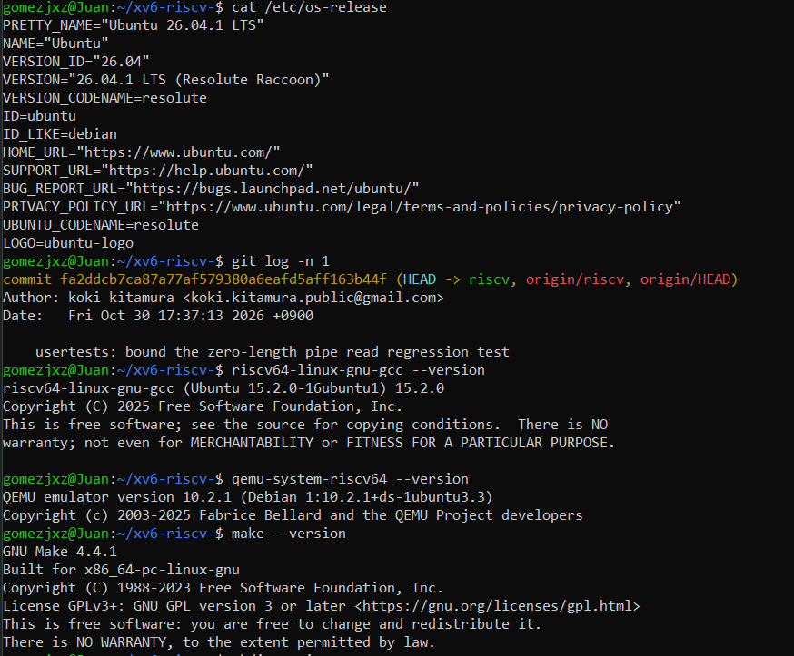
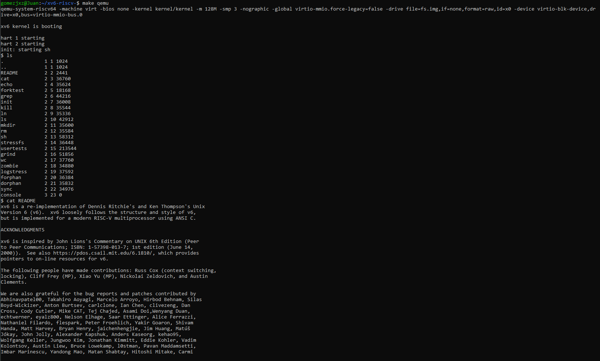
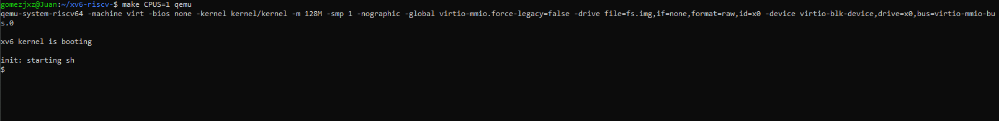

# Práctica XV6 

* Juan Pablo Gomez 2518949
* Santiago Ruiz Vanegas 2177804
* Repositorio (Fork): https://github.com/JuanGomez0708/xv6-riscv-


## 1. Preparación del repositorio y el entorno

### 1.1 Sistema operativo y commit inicial
* Versión de Linux: Ubuntu 26.04.1 LTS (Resolute Raccoon)
* Identificador del commit inicial: `fa2ddcb7ca87a77af579380a6eafd5aff163b44f`

# 1.2 Herramientas de compilación y emulación
* Compilador cruzado: `riscv64-linux-gnu-gcc` versión 15.2.0
* Emulador: qemu-system-riscv64 versión 10.2.1
* Automatización de compilación: GNU Make versión 4.4.1




## 2. Compilar y ejecutar XV6

### 2.1 Evidencia de XV6 operativo
Luego de compilar el código fuente con make qemu e iniciar el sistema operativo en qemu, se ejecutaron los comandos ls y cat README La siguiente imagen demuestra que el kernel arranca correctamente, monta su sistema de archivos y responde a comandos de usuario en el shell:



### 2.2 Ejecución con una sola CPU virtual
Para estudiar la planificación de procesos sobre un único procesador y evitar el paralelismo real entre múltiples núcleos, se ejecutó XV6 limitando la máquina virtual a una sola CPU mediante el parámetro `CPUS=1` en el comando de compilación y arranque:



```bash
make CPUS=1 qemu
```

## 3. Investigación del planificador original de XV6

### 3.1 Algoritmo de planificación por defecto y evidencia de comportamiento
XV6 implementa un algoritmo de planificación **Round-Robin (turno circular)** expropiativo y sin niveles de prioridad. Todos los procesos listos (`RUNNABLE`) tienen la misma jerarquía y reciben turnos sucesivos de ejecución mediante interrupciones periódicas del temporizador (*timer interrupts*).

Al ejecutar procesos concurrentes sobre una única CPU virtual (`make CPUS=1 qemu`), se comprueba que ningún proceso monopoliza el procesador de forma indefinida: cada vez que ocurre una interrupción del reloj, el kernel suspende temporalmente al proceso activo, lo devuelve al estado listo y entrega la CPU al siguiente proceso `RUNNABLE` disponible en la tabla de procesos, repartiendo el tiempo de cómputo de manera equitativa.

### 3.2 Archivo y función donde se selecciona el siguiente proceso
La selección del siguiente proceso se realiza en el archivo **`kernel/proc.c`**, dentro de la función `scheduler(void)` (líneas 429–469). Esta función ejecuta un bucle infinito por cada CPU que recorre secuencialmente el arreglo global de procesos (`proc[NPROC]`) y elige el primer proceso cuyo estado sea `RUNNABLE`:

```c
// Archivo: kernel/proc.c 
void
scheduler(void)
{
  struct proc *p;
  struct cpu *c = mycpu();

  c->proc = 0;
  for (;;) {
    // Habilita y deshabilita interrupciones para evitar interbloqueos
    intr_on();
    intr_off();

    int found = 0;
    for (p = proc; p < &proc[NPROC]; p++) {
      acquire(&p->lock);
      if (p->state == RUNNABLE) {
        // Cambia el estado del proceso elegido y transfiere el contexto de CPU
        p->state = RUNNING;
        c->proc = p;
        swtch(&c->context, &p->context);

        mycpu()->intena = 0;

        // El proceso cedió la CPU; se limpia el puntero activo
        c->proc = 0;
        found = 1;
      }
      release(&p->lock);
    }
    if (found == 0) {
      asm volatile("wfi");
    }
  }
}